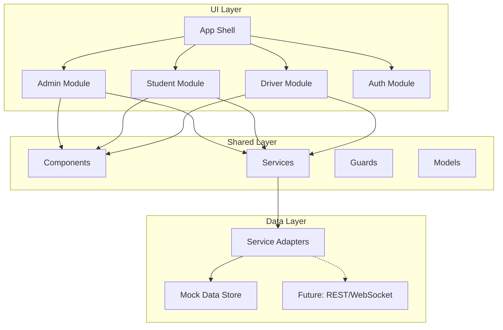

# RouteX - University Bus Tracking System Implementation Plan

A modern, minimal University Bus Tracking System with role-based views (Admin, Student, Driver), built with Angular 21, PrimeNG, and Tailwind CSS. Designed for clarity, accessibility, and future backend integration.

---

## User Review Required

> [!IMPORTANT]
> **Technology Decision**: This plan uses PrimeNG v21 for UI components combined with Tailwind CSS for custom styling. PrimeNG provides ready-made components (Tables, Buttons, Dialogs) while Tailwind handles the custom design system.

> [!IMPORTANT]
> **Map Integration**: For the live map, I recommend using **Leaflet.js** (open-source) or **Google Maps API** (requires API key). Please confirm which you prefer, or if you want a placeholder for now.

> [!WARNING]
> **Breaking Change**: PrimeNG v21 has a new theming system. We'll use their "Aura" preset as a base and customize it with your specified colors.

---

## Project Architecture



---

## Proposed Changes

### Core Configuration

#### [MODIFY] [package.json](file:///d:/Repositories/Semester-Project/frontend/package.json)
Add dependencies:
- `primeng@^21.0.4` - UI Component Library
- `@primeng/themes` - Theming system
- `primeicons` - Icon set
- `leaflet` + `@types/leaflet` - Map integration (if approved)

#### [MODIFY] [angular.json](file:///d:/Repositories/Semester-Project/frontend/angular.json)
- Add PrimeNG styles to build configuration
- Configure theme assets

#### [MODIFY] [styles.css](file:///d:/Repositories/Semester-Project/frontend/src/styles.css)
Extend with design system CSS variables:

```css
@import "tailwindcss";

/* RouteX Design System */
:root {
  /* Primary - Deep Indigo/Blue */
  --rx-primary-50: #eef2ff;
  --rx-primary-100: #e0e7ff;
  --rx-primary-500: #6366f1;
  --rx-primary-600: #4f46e5;
  --rx-primary-700: #4338ca;
  
  /* Secondary - Emerald Green */
  --rx-success-50: #ecfdf5;
  --rx-success-500: #10b981;
  --rx-success-600: #059669;
  
  /* Warning - Amber */
  --rx-warning-50: #fffbeb;
  --rx-warning-500: #f59e0b;
  --rx-warning-600: #d97706;
  
  /* Error - Red */
  --rx-error-500: #ef4444;
  
  /* Neutral - Slate */
  --rx-slate-50: #f8fafc;
  --rx-slate-100: #f1f5f9;
  --rx-slate-200: #e2e8f0;
  --rx-slate-300: #cbd5e1;
  --rx-slate-400: #94a3b8;
  --rx-slate-500: #64748b;
  --rx-slate-600: #475569;
  --rx-slate-700: #334155;
  --rx-slate-800: #1e293b;
  --rx-slate-900: #0f172a;
  --rx-slate-950: #020617;
  
  /* Light Mode Defaults */
  --rx-bg: var(--rx-slate-50);
  --rx-surface: #ffffff;
  --rx-text: var(--rx-slate-900);
  --rx-text-muted: var(--rx-slate-500);
  --rx-border: var(--rx-slate-200);
}

[data-theme="dark"] {
  --rx-bg: var(--rx-slate-950);
  --rx-surface: var(--rx-slate-900);
  --rx-text: var(--rx-slate-100);
  --rx-text-muted: var(--rx-slate-400);
  --rx-border: var(--rx-slate-700);
}
```

#### [MODIFY] [index.html](file:///d:/Repositories/Semester-Project/frontend/src/index.html)
- Add Inter/Roboto font from Google Fonts
- Add meta tags for SEO and PWA readiness
- Set default theme attribute

---

### Folder Structure

#### [NEW] Complete Project Structure

```
src/app/
├── core/                          # Singleton services & guards
│   ├── guards/
│   │   └── role.guard.ts          # Role-based route protection
│   ├── services/
│   │   ├── auth.service.ts        # Authentication & role management
│   │   ├── theme.service.ts       # Light/Dark mode toggle
│   │   └── notification.service.ts
│   └── interceptors/
│       └── api.interceptor.ts     # Future: HTTP interceptor
│
├── shared/                        # Reusable across modules
│   ├── components/
│   │   ├── header/                # Top navigation with branding
│   │   ├── sidebar/               # Admin sidebar navigation
│   │   ├── status-badge/          # On Route, Arriving, Delayed
│   │   ├── eta-chip/              # ETA display chip
│   │   ├── route-card/            # Route summary card
│   │   ├── bus-marker/            # Animated map marker
│   │   └── loading-spinner/
│   ├── layouts/
│   │   ├── main-layout/           # Student/Driver layout
│   │   └── admin-layout/          # Admin dashboard layout
│   └── pipes/
│       └── time-ago.pipe.ts
│
├── data/                          # Data layer (mock → API ready)
│   ├── models/
│   │   ├── user.model.ts
│   │   ├── route.model.ts
│   │   ├── bus.model.ts
│   │   ├── stop.model.ts
│   │   └── location.model.ts
│   ├── mock/
│   │   ├── users.data.ts
│   │   ├── routes.data.ts
│   │   ├── buses.data.ts
│   │   └── stops.data.ts
│   ├── services/
│   │   ├── base-data.service.ts   # Abstract base with interface
│   │   ├── route.service.ts
│   │   ├── bus.service.ts
│   │   ├── user.service.ts
│   │   └── tracking.service.ts    # GPS simulation
│   └── adapters/
│       ├── mock.adapter.ts        # Current: In-memory
│       └── api.adapter.ts         # Future: REST API
│
├── features/
│   ├── auth/                      # Login & role selection
│   │   ├── auth.routes.ts
│   │   └── pages/
│   │       └── login/
│   │
│   ├── student/                   # Student view (read-only)
│   │   ├── student.routes.ts
│   │   └── pages/
│   │       ├── dashboard/         # Route list + map
│   │       ├── route-detail/      # Stops & live tracking
│   │       └── favorites/
│   │
│   ├── driver/                    # Driver view (GPS simulator)
│   │   ├── driver.routes.ts
│   │   └── pages/
│   │       └── tracking/          # Start/Stop + status
│   │
│   └── admin/                     # Admin dashboard
│       ├── admin.routes.ts
│       └── pages/
│           ├── dashboard/         # System overview
│           ├── routes/            # Route CRUD
│           ├── drivers/           # Driver management
│           ├── students/          # Student management
│           └── assignments/       # Driver ↔ Route
│
└── app.ts                         # Root component
```

---

### Data Models

#### [NEW] [user.model.ts](file:///d:/Repositories/Semester-Project/frontend/src/app/data/models/user.model.ts)

```typescript
export type UserRole = 'admin' | 'student' | 'driver';

export interface User {
  id: string;
  email: string;
  name: string;
  role: UserRole;
  avatar?: string;
  // Driver-specific
  assignedRouteId?: string;
  isTracking?: boolean;
  // Student-specific
  favoriteRouteIds?: string[];
}
```

#### [NEW] [route.model.ts](file:///d:/Repositories/Semester-Project/frontend/src/app/data/models/route.model.ts)

```typescript
export interface Route {
  id: string;
  name: string;
  shortCode: string;        // e.g., "R1", "Express"
  description?: string;
  stops: Stop[];
  estimatedDuration: number; // minutes
  isActive: boolean;
  assignedDriverId?: string;
  assignedBusId?: string;
}

export interface Stop {
  id: string;
  name: string;
  location: GeoLocation;
  order: number;
  estimatedArrival?: Date;
}

export interface GeoLocation {
  lat: number;
  lng: number;
}
```

#### [NEW] [bus.model.ts](file:///d:/Repositories/Semester-Project/frontend/src/app/data/models/bus.model.ts)

```typescript
export type BusStatus = 'on-route' | 'arriving' | 'delayed' | 'idle' | 'offline';

export interface Bus {
  id: string;
  plateNumber: string;
  capacity: number;
  status: BusStatus;
  currentLocation?: GeoLocation;
  lastUpdated?: Date;
  currentRouteId?: string;
  nextStopId?: string;
  eta?: number; // minutes to next stop
}
```

---

### Core Services

#### [NEW] [auth.service.ts](file:///d:/Repositories/Semester-Project/frontend/src/app/core/services/auth.service.ts)

```typescript
import { Injectable, signal, computed } from '@angular/core';
import { User, UserRole } from '../../data/models/user.model';

@Injectable({ providedIn: 'root' })
export class AuthService {
  private currentUser = signal<User | null>(null);
  
  readonly user = this.currentUser.asReadonly();
  readonly isAuthenticated = computed(() => !!this.currentUser());
  readonly role = computed(() => this.currentUser()?.role);
  readonly isAdmin = computed(() => this.role() === 'admin');
  readonly isStudent = computed(() => this.role() === 'student');
  readonly isDriver = computed(() => this.role() === 'driver');
  
  // Simulated login for mock phase
  login(role: UserRole): void { /* ... */ }
  logout(): void { /* ... */ }
}
```

#### [NEW] [tracking.service.ts](file:///d:/Repositories/Semester-Project/frontend/src/app/data/services/tracking.service.ts)

```typescript
import { Injectable, signal } from '@angular/core';
import { interval } from 'rxjs';

@Injectable({ providedIn: 'root' })
export class TrackingService {
  private isTracking = signal(false);
  private simulationInterval$ = interval(3000); // 3s updates
  
  readonly tracking = this.isTracking.asReadonly();
  
  // Mock GPS simulation
  startTracking(routeId: string): void { /* ... */ }
  stopTracking(): void { /* ... */ }
  
  // Future: WebSocket connection
  // connectRealtime(routeId: string): Observable<GeoLocation>
}
```

---

### Route Configuration

#### [MODIFY] [app.routes.ts](file:///d:/Repositories/Semester-Project/frontend/src/app/app.routes.ts)

```typescript
import { Routes } from '@angular/router';
import { roleGuard } from './core/guards/role.guard';

export const routes: Routes = [
  { path: '', redirectTo: 'login', pathMatch: 'full' },
  
  {
    path: 'login',
    loadComponent: () => import('./features/auth/pages/login/login.component')
      .then(m => m.LoginComponent)
  },
  
  {
    path: 'student',
    canActivate: [roleGuard('student')],
    loadChildren: () => import('./features/student/student.routes')
      .then(m => m.STUDENT_ROUTES)
  },
  
  {
    path: 'driver',
    canActivate: [roleGuard('driver')],
    loadChildren: () => import('./features/driver/driver.routes')
      .then(m => m.DRIVER_ROUTES)
  },
  
  {
    path: 'admin',
    canActivate: [roleGuard('admin')],
    loadChildren: () => import('./features/admin/admin.routes')
      .then(m => m.ADMIN_ROUTES)
  },
  
  { path: '**', redirectTo: 'login' }
];
```

---

### UI Components (Examples)

#### [NEW] Status Badge Component

```typescript
// shared/components/status-badge/status-badge.component.ts
import { Component, input, computed } from '@angular/core';
import { BusStatus } from '../../../data/models/bus.model';

@Component({
  selector: 'rx-status-badge',
  standalone: true,
  template: `
    <span [class]="badgeClass()">
      <span class="status-dot"></span>
      {{ label() }}
    </span>
  `
})
export class StatusBadgeComponent {
  status = input.required<BusStatus>();
  
  label = computed(() => {
    const labels: Record<BusStatus, string> = {
      'on-route': 'On Route',
      'arriving': 'Arriving',
      'delayed': 'Delayed',
      'idle': 'Idle',
      'offline': 'Offline'
    };
    return labels[this.status()];
  });
  
  badgeClass = computed(() => {
    const base = 'inline-flex items-center gap-1.5 px-2 py-1 rounded-full text-xs font-medium';
    const variants: Record<BusStatus, string> = {
      'on-route': 'bg-emerald-100 text-emerald-700 dark:bg-emerald-900/30 dark:text-emerald-400',
      'arriving': 'bg-blue-100 text-blue-700 dark:bg-blue-900/30 dark:text-blue-400',
      'delayed': 'bg-amber-100 text-amber-700 dark:bg-amber-900/30 dark:text-amber-400',
      'idle': 'bg-slate-100 text-slate-600 dark:bg-slate-800 dark:text-slate-400',
      'offline': 'bg-red-100 text-red-700 dark:bg-red-900/30 dark:text-red-400'
    };
    return `${base} ${variants[this.status()]}`;
  });
}
```

---

### View Layouts

#### Student View (Mobile-First)
```
┌─────────────────────────────────────┐
│  🚌 RouteX        [🌙] [👤]        │ ← Sticky Header
├─────────────────────────────────────┤
│  ┌─────────────────────────────┐   │
│  │                             │   │
│  │       LIVE MAP VIEW         │   │
│  │       (bus markers)         │   │
│  │                             │   │
│  └─────────────────────────────┘   │
├─────────────────────────────────────┤
│  📍 Route 1 - Main Campus          │
│  [On Route] ETA: 5 min             │
├─────────────────────────────────────┤
│  📍 Route 2 - Hostel Loop          │
│  [Delayed] ETA: 12 min             │
├─────────────────────────────────────┤
│  📍 Route 3 - Library Express      │
│  [Arriving] ETA: 2 min             │
└─────────────────────────────────────┘
       [🏠] [🗺️] [⭐] [⚙️]           ← Bottom Navigation
```

#### Driver View (Minimal)
```
┌─────────────────────────────────────┐
│  🚌 RouteX Driver  [Logout]         │
├─────────────────────────────────────┤
│                                     │
│     Assigned Route: R1 Main         │
│     Current Status: [On Route]      │
│                                     │
│  ┌───────────────────────────────┐  │
│  │        Current Location       │  │
│  │     Lat: 33.6844, Lng: 73.04  │  │
│  │        Updated: 3s ago        │  │
│  └───────────────────────────────┘  │
│                                     │
│   ┌─────────────────────────────┐   │
│   │                             │   │
│   │    [ START TRACKING ]       │   │ ← Large, easy tap
│   │                             │   │
│   └─────────────────────────────┘   │
│                                     │
│   Next Stop: Library Gate           │
│   Progress: ████████░░ 80%          │
│                                     │
└─────────────────────────────────────┘
```

#### Admin View (Dashboard)
```
┌──────────────────────────────────────────────────────────────────┐
│  🚌 RouteX Admin                              [🌙] [🔔] [👤]    │
├──────────┬───────────────────────────────────────────────────────┤
│          │                                                       │
│ Dashboard│   System Overview                                     │
│          │   ┌─────────┐ ┌─────────┐ ┌─────────┐ ┌─────────┐    │
│ Routes   │   │ 8 Active│ │ 12 Buses│ │ 3 Delayed│ │250 Users│    │
│          │   │ Routes  │ │ Online  │ │ Routes  │ │ Today   │    │
│ Drivers  │   └─────────┘ └─────────┘ └─────────┘ └─────────┘    │
│          │                                                       │
│ Students │   Live Map                                            │
│          │   ┌───────────────────────────────────────────────┐  │
│ Assign   │   │                                               │  │
│          │   │              FULL MAP VIEW                    │  │
│ Settings │   │              (all routes)                     │  │
│          │   └───────────────────────────────────────────────┘  │
│          │                                                       │
│          │   Recent Activity                                     │
│          │   • Bus R1 started tracking at 9:00 AM               │
│          │   • Route 3 marked as delayed (traffic)              │
│          │   • New student registered: john@uni.edu             │
└──────────┴───────────────────────────────────────────────────────┘
```

---

## Verification Plan

### Automated Tests
```bash
# Unit tests for services
npm run test

# Build verification
npm run build
```

### Browser Testing
1. **Light/Dark Mode Toggle**: Verify theme switches correctly
2. **Role-Based Access**: Test login as each role, verify correct view loads
3. **Responsive Design**: Test on 375px (mobile), 768px (tablet), 1440px (desktop)
4. **Route Guards**: Attempt to access `/admin` as student, verify redirect

### Manual Verification
1. **Student Flow**: Login → View routes → Select route → See ETA updates
2. **Driver Flow**: Login → Start tracking → Verify location updates simulate
3. **Admin Flow**: Login → CRUD routes → Assign driver → View dashboard stats
4. **Accessibility**: Run Lighthouse audit, verify contrast ratios meet WCAG AA

---

## Implementation Order

| Phase | Components | Duration |
|-------|-----------|----------|
| 1 | Foundation (PrimeNG setup, theme, layouts) | 1-2 days |
| 2 | Data Layer (models, mock data, services) | 1 day |
| 3 | Shared Components (badges, cards, header) | 1-2 days |
| 4 | Auth + Routing + Guards | 0.5 day |
| 5 | Student View (dashboard, route detail) | 1-2 days |
| 6 | Driver View (tracking simulator) | 1 day |
| 7 | Admin View (dashboard, CRUD pages) | 2-3 days |
| 8 | Polish (animations, a11y, testing) | 1 day |

**Estimated Total: 8-13 days**

---

## Questions for Clarification

1. **Map Provider**: Do you prefer **Leaflet** (free, open-source) or **Google Maps** (requires API key)?
2. **Authentication**: Should the login page have actual form fields (email/password), or just role selection buttons for the mock phase?
3. **University Branding**: Do you have any specific university logo, name, or colors to incorporate?
